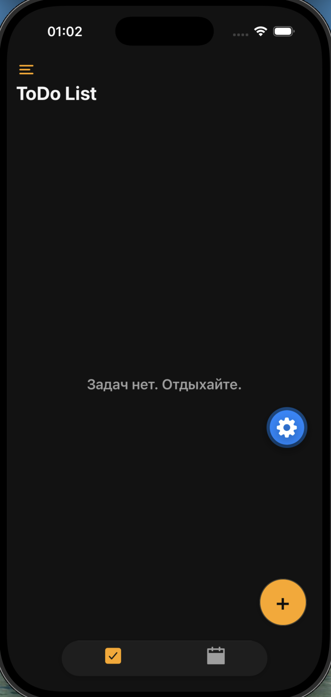
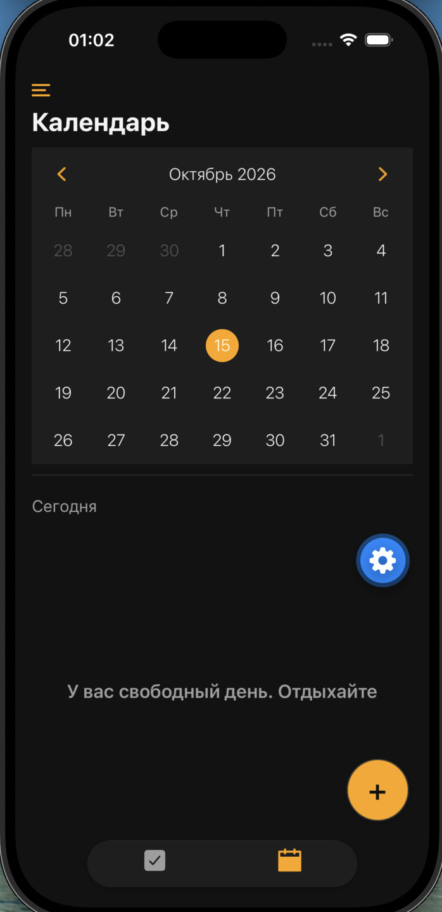
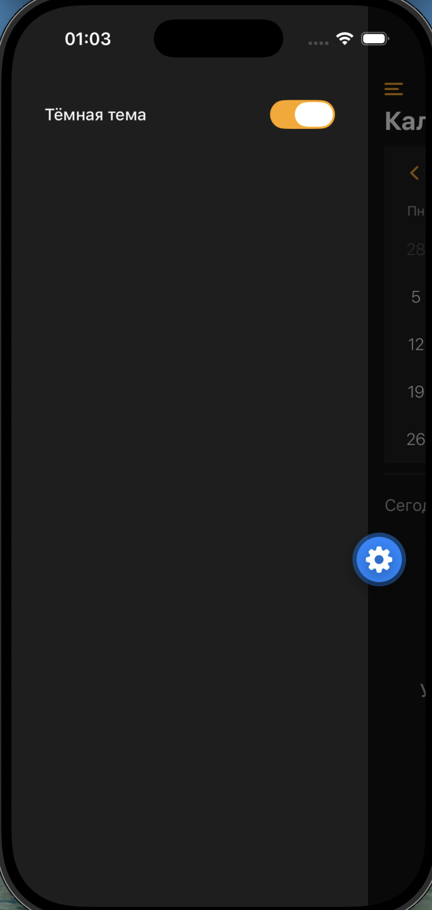
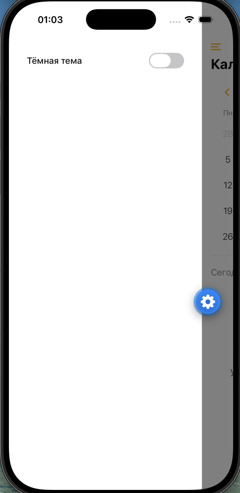
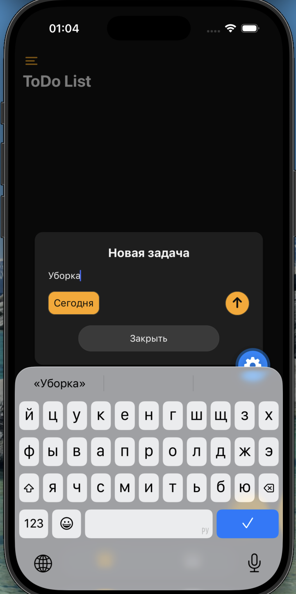
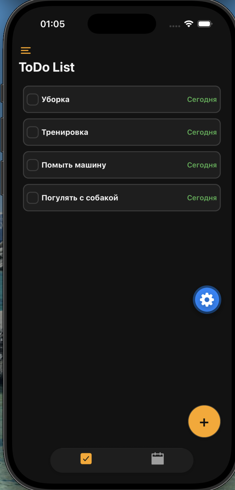
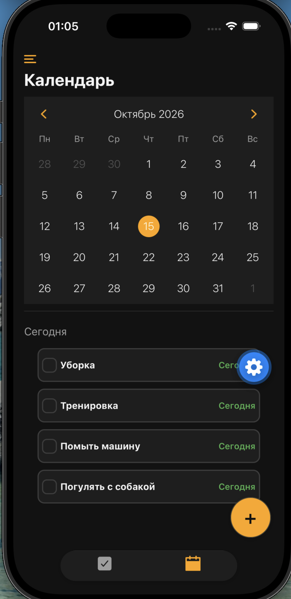
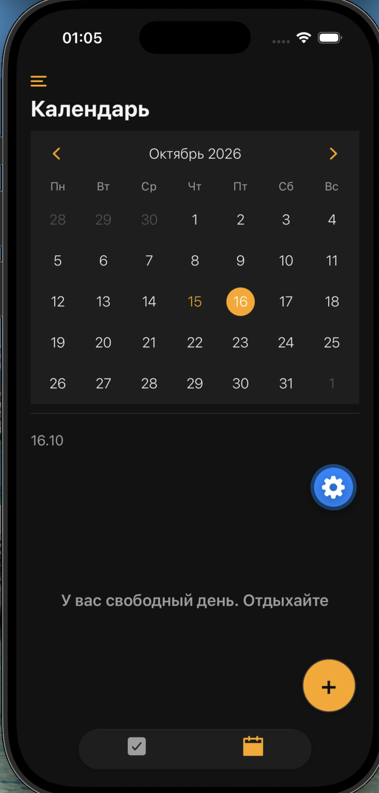

# ToDo — мобильное приложение для управления задачами

Кроссплатформенное ToDo-приложение для **iOS, Android и Web**, написанное на **Expo / React Native** с использованием **TypeScript**. Интерфейс полностью на русском языке. Все данные хранятся локально на устройстве — приложение работает без бэкенда и без интернета.

## Возможности

- **Создание задач.** Плавающая кнопка «+» открывает форму, где задаётся текст задачи и дата.
- **Редактирование задач.** Тап по задаче открывает ту же форму с уже заполненными текстом и датой.
- **Отметка о выполнении.** Чекбокс слева или свайп влево (действие «Готово» / «Вернуть»). Выполненные задачи зачёркиваются.
- **Удаление.** Свайп вправо по задаче с действием «Удалить».
- **Сортировка.** Невыполненные задачи всегда идут выше выполненных, внутри группы — по дате.
- **Подсветка дат.** Сегодняшние и будущие даты выделяются одним цветом, просроченные — другим.
- **Календарь по дням.** Вкладка «Календарь» показывает задачи выбранного дня; если задач нет — сообщение «У вас свободный день. Отдыхайте». Календарь русифицирован (месяцы, дни недели, «Сегодня»).
- **Тёмная и светлая темы.** Переключатель «Тёмная тема» находится в боковом меню (drawer). Выбор сохраняется между запусками.
- **Локальное хранение.** Задачи и выбранная тема сохраняются на устройстве через AsyncStorage и переживают перезапуск приложения.
- **Стартовый набор.** При первом запуске добавляются две демонстрационные задачи.

## Технологии

| Область          | Что используется                                                |
| ---------------- | --------------------------------------------------------------- |
| Платформа        | Expo SDK 57, React Native 0.86.3, React 19.2.3                  |
| Язык             | TypeScript (strict)                                             |
| Навигация        | React Navigation — Drawer + Bottom Tabs                         |
| Состояние        | React Context (`TaskContext`, `ThemeContext`, `AddTaskContext`) |
| Хранение         | `@react-native-async-storage/async-storage`                     |
| Календарь        | `react-native-calendars`                                        |
| Жесты / анимации | `react-native-gesture-handler`, `react-native-reanimated`       |
| Иконки           | `@expo/vector-icons`                                            |
| Дата-пикер       | `@react-native-community/datetimepicker`                        |

## Структура проекта

```
index.ts                     точка входа (registerRootComponent)
App.tsx                      провайдеры контекстов и навигация
app.json                     конфигурация Expo
theme/colors.ts              палитры светлой и тёмной темы
navigation/
  AppNavigator.tsx           NavigationContainer + тема навигации
  DrawerNavigation.tsx       боковое меню с переключателем темы
  TabsNavigation.tsx         нижние вкладки ToDo / Calendar + общая кнопка «+» и модалка
context/
  TaskContext.tsx            список задач, CRUD и сохранение
  ThemeContext.tsx           тема и её сохранение
  AddTaskContext.tsx         состояние формы задачи и выбранный день календаря
services/storage.ts          обёртки над AsyncStorage
screens/
  ToDoScreen.tsx             главный список задач
  CalendarScreen.tsx         календарь и задачи выбранного дня
components/
  Header.tsx                 заголовок «ToDo List»
  ToDo.tsx                   список задач со свайпами и чекбоксами
  AddTaskButton.tsx          плавающая кнопка «+»
  AddTaskModal.tsx           форма создания и редактирования задачи
data/initialTasks.ts         стартовые задачи
types/task.ts                тип Task
utils/dateUtils.ts           работа с датами задач
```

## Запуск

Установите зависимости и запустите дев-сервер:

```bash
npm install
npx expo start          # откроется меню, где можно нажать i / a / w
npx expo start --ios    # iOS-симулятор
npx expo start --android # Android-эмулятор
npx expo start --web    # веб-версия
```

Проверка типов:

```bash
npx tsc --noEmit
```

> Приложение использует нативные модули (дата-пикер, жесты). Для запуска удобнее всего **development build**:
> `npx expo run:ios` / `npx expo run:android` или сборка через EAS.

## Скриншоты










## Планы по развитию

- Категории и приоритеты задач.
- Напоминания и уведомления.
- Поиск и фильтры.
- Синхронизация между устройствами.

## Лицензия

MIT — см. файл [LICENSE](./LICENSE).
